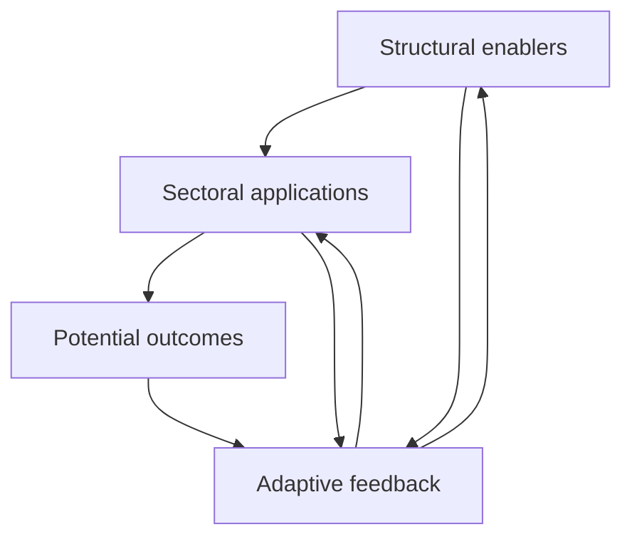

# Adaptive deployment framework

Source: Section 8, printed pages 25-27, and Figure 4 on printed page 26. This explanation and diagram are new companion adaptations, not new empirical results.

## Four interacting layers

| Layer | Role in the paper | Companion reading question |
| --- | --- | --- |
| Structural enablers | Technology, data, infrastructure, governance, capacity, equity and coordination | What evidence shows that each necessary condition exists in this context? |
| Sectoral applications | Healthcare, agriculture, education and environmental management | How will the application fit the actual service, users and operating environment? |
| Potential outcomes | Improved services, productivity, inclusion, resilience and environmental monitoring | Which outcomes are measured, over what period, and against what baseline? |
| Adaptive feedback | Monitoring, evaluation, user input and learning | Who reviews changing conditions and can authorise corrective action? |

## Simplified topology

This is a compact interpretation of the relationships described in the article, not a reproduction of the artwork in Figure 4.

The feedback layer gathers information from enabling conditions, implementation and outcomes, then informs redesign and changes to deployment. An outcome arrow represents a proposed relationship; it does not establish that an intervention causes an SDG improvement.

## Six context dimensions

Table 4 (printed page 12) distinguishes computational resources, data resources, infrastructure, institutional resources, human capacity, and equity/access. These dimensions are mapped into `catalogue/deployment_dimensions.csv` and the blank discussion worksheet.

The worksheet is a newly created operational aid. It is not a survey instrument used in the paper. It has no weights, numeric thresholds, country ranking or clinical/procurement approval logic. Its state counts are descriptive and must not be interpreted as readiness scores.

## Suggested discussion process

1. Define a specific application, institution and operating context.
2. Record observed conditions and the source/date of supporting evidence for each dimension.
3. Ask relevant stakeholders to review gaps and competing interpretations.
4. Record the responsible owner and next review date.
5. Revisit the evidence as infrastructure, users, governance or objectives change.

These are new companion prompts based on the adaptive logic, not a validated procedure reported in the article. The paper identifies empirical framework testing and longitudinal evaluation as future work.
